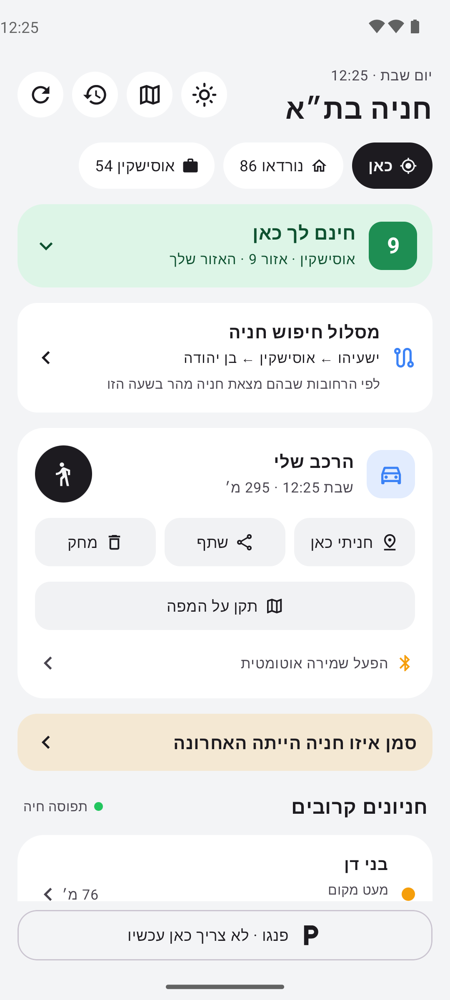
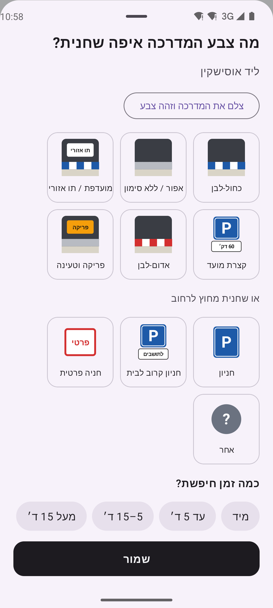
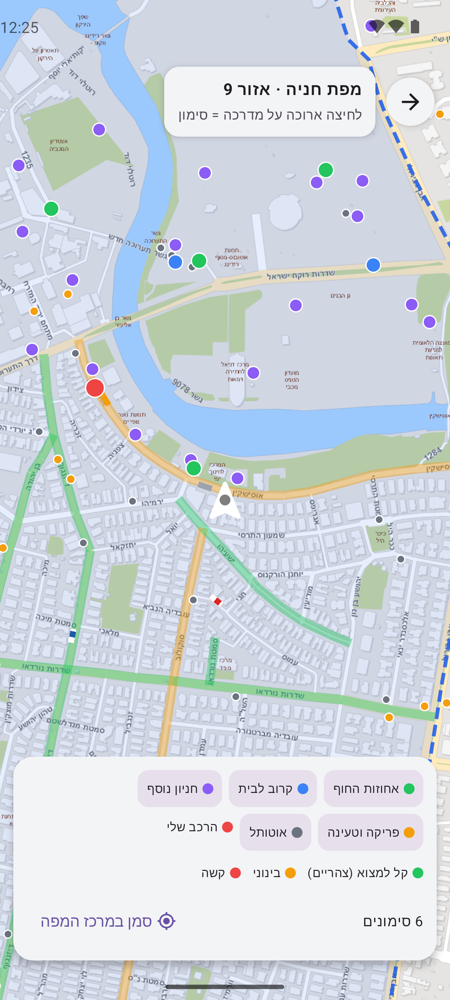
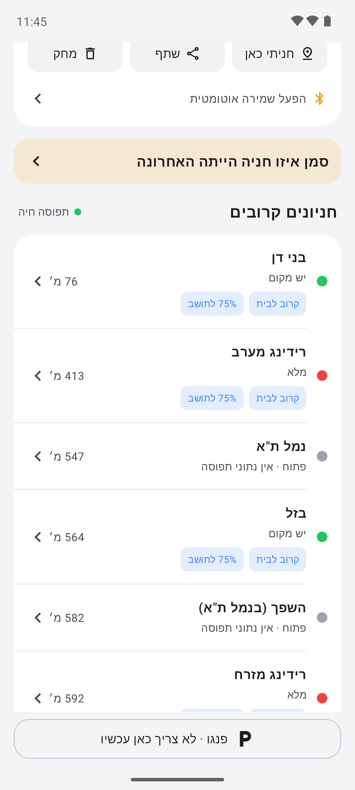
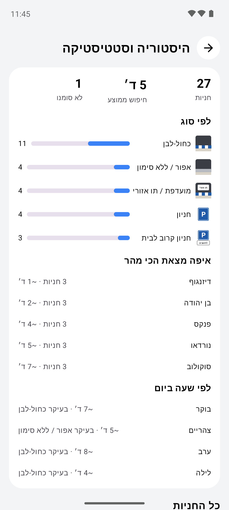
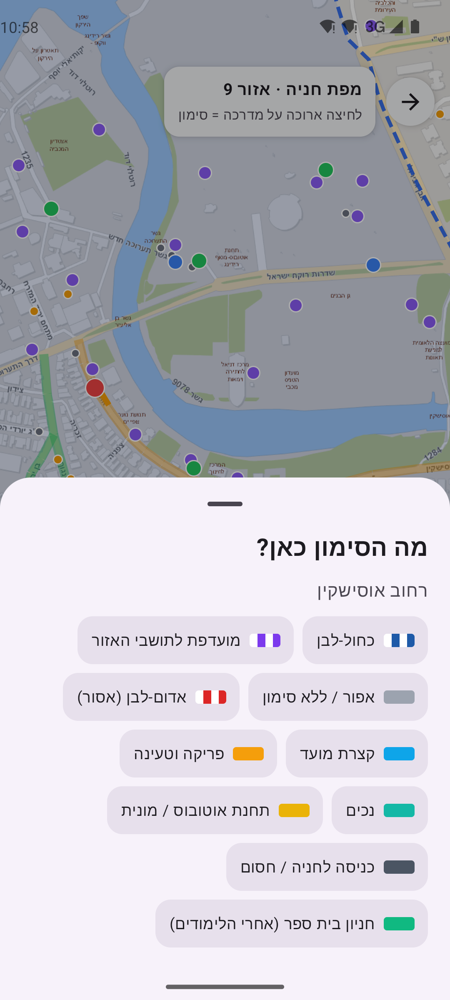
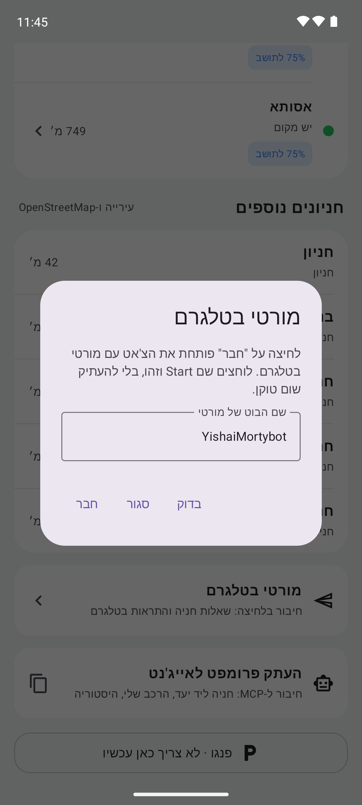
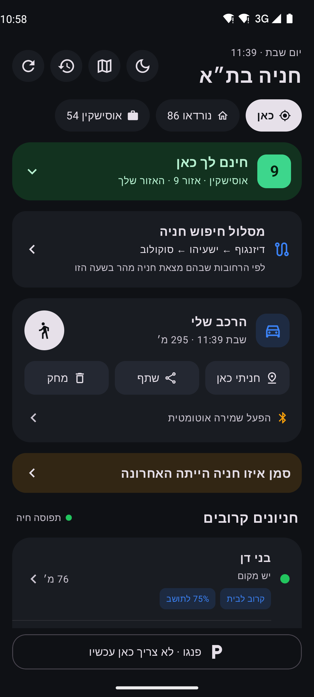
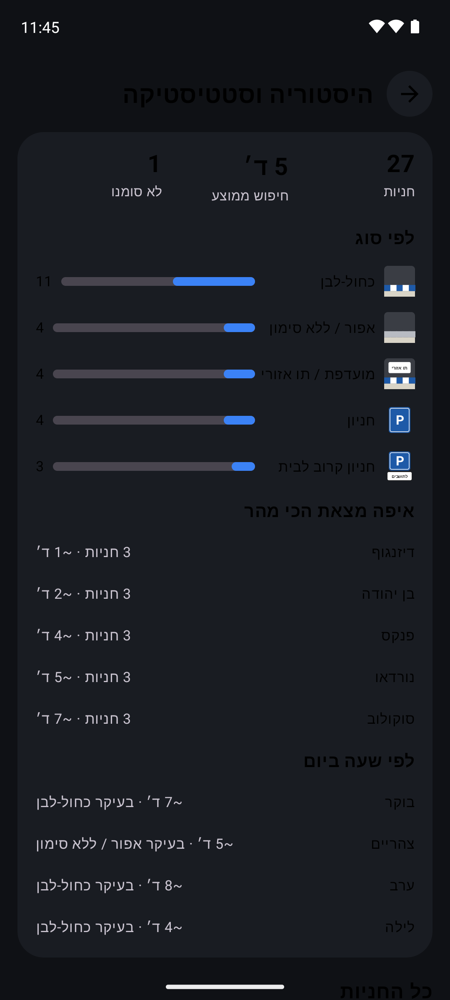

# חניה בת״א · parking-tlv

אפליקציית חניה אישית לבעל תו חניה של אזור 9 בתל אביב (נורדאו 86, אוסישקין 54). היא עונה על שלוש שאלות:

1. **מה החוק בדיוק כאן ועכשיו:** חינם, כמה זמן, ואם צריך פנגו.
2. **איפה הכי שווה לחנות:** רחוב, חניון עם תפוסה חיה, או חניון "קרוב לבית".
3. **איפה הרכב.**

יש לה גם תזכורות פנגו, מפה של אזור 9 עם סימוני מדרכה, היסטוריה וסטטיסטיקה, Android Auto, ווידג'ט, ומורטי בטלגרם.

## צילומי מסך

הצילומים נוצרים אוטומטית מהרצה על אמולטור עם נתוני דוגמה, בכל גרסה.

<table>
<tr>
<td align="center"> החוק בנקודה המדויקת</td>
<td align="center"> אחרי חניה: מה צבע המדרכה?</td>
<td align="center"> מפת אזור 9</td>
</tr>
<tr>
<td align="center"> חניונים עם תפוסה חיה</td>
<td align="center"> היסטוריה וסטטיסטיקה</td>
<td align="center"> סימון מדרכה במפה</td>
</tr>
<tr>
<td align="center"> חיבור למורטי בטלגרם</td>
<td align="center"> מצב כהה</td>
<td align="center"> היסטוריה במצב כהה</td>
</tr>
</table>

## התקנה

1. מורידים את `parking-tlv-v<גרסה>.apk` מ-[Releases](https://github.com/yishaik/Parking-tlv/releases/latest) ומתקינים. כל גרסה מותקנת מעל הקודמת בלי למחוק נתונים.
2. **הרשאות:**
   - **מיקום:** כדי לדעת באיזה אזור אתה.
   - **מיקום "כל הזמן":** לשמירה אוטומטית כשהבלוטות' של הרכב מתנתק.
   - **התראות:** תזכורות פנגו וזמן חינם.
   - **בלוטות':** לבחירת הרכב.
3. **שמירה אוטומטית:** במסך הראשי ← "הפעל שמירה אוטומטית" ← בוחרים את הבלוטות' של הרכב.
4. **Android Auto:** אפליקציה שלא הותקנה מ-Play צריכה אישור חד-פעמי:
   - נכנסים להגדרות Android Auto ← לוחצים 10 פעמים על "גרסה" ← "מקורות לא ידועים".
5. **מורטי בטלגרם (רשות):** "מורטי בטלגרם" ← "חבר" ← Start בטלגרם. בלי להעתיק טוקן.

## שימוש

### חניה
- **שמירת החניה:** קורה לבד כשמכבים את הרכב (ניתוק בלוטות' או יציאה מ-Android Auto). אפשר גם ידנית מ"חניתי כאן", מהווידג'ט, מהאריח בהגדרות המהירות, או מ"חניתי" ב-Android Auto.
- **צבע המדרכה:** מיד אחרי השמירה קופצת שאלה. בוחרים מההתראה (כחול-לבן, אפור) או פותחים את כל האפשרויות. אפשר גם לצלם את המדרכה ולקבל הצעה, שתמיד מחכה לאישור שלך. כל סימון נכנס למפה ולסטטיסטיקה.
- **תזכורות:** מחוץ לאזור 9 ("שעתיים חינם, רק עם פנגו") האפליקציה מזכירה:
  - להפעיל פנגו כשצריך
  - לפני תחילת שעות התשלום
  - 10 דקות לפני סוף הזמן החינם, ובסופו
  - בסוף חניה קצרת מועד
  - בסוף חניה בפנגו

  התזכורות שורדות הפעלה מחדש של הטלפון.

### מסכים
- **המסך הראשי:**
  - כרטיס עם החוק בנקודה המדויקת: האזור, הרחוב, שעות התשלום, ומה לעשות.
  - מעליו בחירה בין "כאן", נורדאו 86 ואוסישקין 54.
  - כפתור פנגו בולט רק כשבאמת צריך.
- **מפה:**
  - אזור 9, חניונים, תמרורי פריקה וטעינה, אוטותל, הרכב, וסיכויים לפי רחוב.
  - המקרא הוא גם מתג. בזום רחוק מוצגות רק השכבות החשובות.
  - לחיצה ארוכה על מדרכה מוסיפה סימון.
- **היסטוריה:** כל החניות, איפה מצאת הכי מהר, וחיפוש לפי שעה ביום.

### עוד
- **חדשות:** חניה חינם בחירום, שינויי מחיר ואירועים בפארק הירקון או בנמל מופיעים כבאנר. חניה חינם מופעלת רק אחרי שאתה מאשר.
- **מורטי בטלגרם:** אפשר לשאול "איפה לחנות ליד דיזנגוף 50 ב-20:00" או "איפה הרכב". תזכורות פנגו, חניון שהתפנה, חניה חינם וסיכום שבועי מגיעים גם לטלגרם.
- **אייג'נטים אחרים:** הכרטיס "פרומפט לאייג'נט" מעתיק הוראות חיבור לשרת ה-MCP.

## החוקים שהאפליקציה מכירה

| איפה | מה |
|---|---|
| אזור 9 (האזור שלך) | חינם כל היממה, בלי אפליקציה, גם בקטעי "חניה מועדפת" של אזור 9 |
| רחוב גובל (עד 25 מ׳ מגבול אזור 9) | חינם לך, אבל חובה פנגו מהדקה הראשונה |
| אזורי המרכז 6, 7, 10 | תשלום א׳–ה׳ 08:00–21:00, ו׳ וערבי חג 08:00–17:00. לך: שעתיים ביום חינם (מצטבר), רק עם פנגו, ואחר כך ₪8.68 לשעה (30% הנחת תושב). |
| אזורי החוץ 1, 2, 4, 12, 13 | תשלום א׳–ה׳ 08:00–19:00, ו׳ 08:00–17:00. לך: שעתיים חינם עם פנגו, ואחר כך ₪4.90 לשעה. |
| שבת וחג | אין תשלום ברחוב. חג נחשב כמו שבת, וזו הנחה. |
| חניון "קרוב לבית" שמשויך אליך | חינם א׳–ה׳ 19:00–08:00, ו׳ וערב חג מ-15:00, שבת וחג |

המקור הוא `config/rules.json`, עם הפניות לאתר העירייה. התעריפים בחניוני אחוזות החוף נלקחים מהטקסט של העירייה ולא מנוחשים.

## פרטיות ונתונים

| מה | איפה |
|---|---|
| **בטלפון** | היסטוריה, סימוני מדרכה, מקום הרכב, הגדרות, ויומן קריסות (רק אם הייתה קריסה) |
| **בשרת** (Supabase, פרויקט פרטי) | חניות, סימוני מדרכה, החניונים שמשויכים אליך, וטוקנים |

- מי ניגש לשרת: רק האפליקציה שלך, עם טוקן הבעלים, ואייג'נטים שחיברת בעצמך, עם גישת קריאה בלבד.
- יומן הקריסות לא נשלח לשום מקום, אלא אם לוחצים "שלח דוח".

## כשמשהו לא עובד

| מה קורה | מה לעשות |
|---|---|
| החניה לא נשמרת כשמכבים את הרכב | צריך מיקום "כל הזמן", וצריך שהרכב שנבחר יהיה הבלוטות' הנכון. Android Auto שומר לבד כשהוא מתנתק. |
| אין תזכורות | לאשר התראות לאפליקציה. בחלק מהטלפונים צריך גם לבטל "חיסכון בסוללה" לאפליקציה. |
| "אין חיבור לשרת" | האפליקציה עובדת גם בלעדיו. אם הבעיה נמשכת אחרי התקנה נקייה, ראו "בעלים חדש" ב-[פיתוח](docs/DEVELOPMENT.md). |
| מורטי לא עונה ל-Start | מורטי צריך להיות בגרסה 0.11 ומעלה (שולחים לו `/update`). הקוד תקף עשר דקות, אז אם עבר יותר לוחצים "חבר" שוב. |
| Android Auto לא מציג את האפליקציה | צריך "מקורות לא ידועים" בהגדרות המפתחים של Android Auto (ראו "התקנה"). |
| כרטיס "האפליקציה נתקלה בשגיאה" | "שלח דוח" ושולחים אותו. אחרי שזה טופל, "נקה". |

## מגבלות ידועות

- **צבעי המדרכה:** אין להם מקור פתוח ברמת הרחוב. המפה נבנית מהסימונים שלך ומסוג החניה שאתה בוחר.
- **תפוסה ברחוב:** אין נתונים. "הסיכויים" מבוססים על ההיסטוריה שלך.
- **חניוני בתי ספר:** אין רשימה ציבורית של חניונים שנפתחים אחרי הלימודים. יש סוג סימון בשבילם.
- **אירועים ושינויי מחיר:** מגיעים מחדשות, לא מלוח רשמי. מוצגים כאות, לא כחוק.
- **מעקב חניון:** נבדק כל 15 דקות לכל היותר, כי זה המינימום של אנדרואיד.
- **זיהוי צבע מתמונה:** הערכה, ולכן תמיד מחכה לאישור.

## לעומק

- [ארכיטקטורה](docs/ARCHITECTURE.md): הרכיבים, מקורות המידע, ואיך חניה נשמרת
- [השרת](docs/API.md): נקודות קצה, כלי MCP, חיבור אייג'נטים וערוץ ההתראות
- [פיתוח, בדיקות ושחרור](docs/DEVELOPMENT.md)
- [שינויים](CHANGELOG.md)

