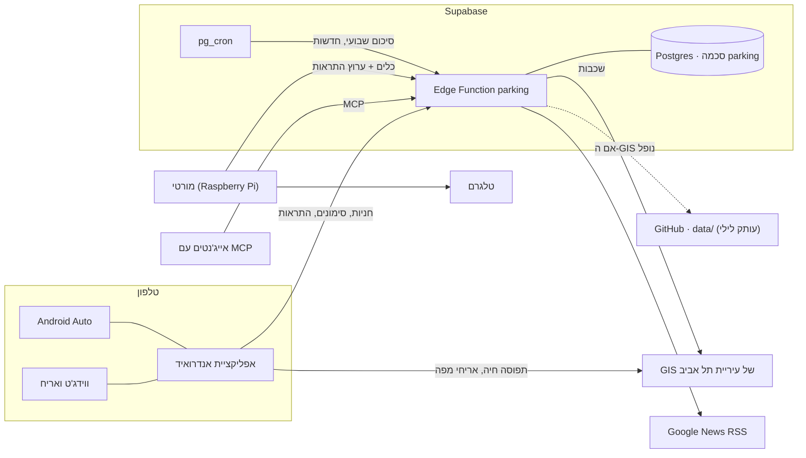
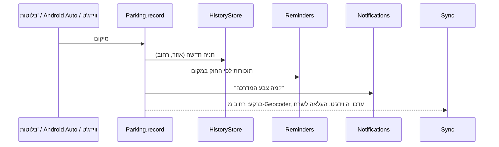

# ארכיטקטורה

<div dir="rtl">

## התמונה הכללית



**העיקרון:** האפליקציה עובדת לבד. החוקים, האזורים והחניונים ארוזים בתוכה, והשרת רק מוסיף: סנכרון, MCP לאייג'נטים, ערוץ התראות ומשימות מתוזמנות.

## מקורות המידע

| מקור | מה נותן | איפה בקוד |
|---|---|---|
| GIS עירוני, שכבה 544 | אזורי חניה, ומהם גם רחובות גובלים (עד 25 מ׳ מגבול אזור 9) | `scripts/sync.ts`, `Data.kt`, `tools.ts` |
| שכבה 970 | חניוני אחוזות החוף: תפוסה חיה ותעריפים | `Data.garages()`, `liveGarages()` |
| שכבה 488 | חניונים "קרוב לבית" | |
| שכבה 556 | חניונים ציבוריים | |
| שכבה 449 | תמרורי פריקה וטעינה, עם הטקסט שעליהם | |
| שכבה 602 | חניות אוטותל | |
| שכבה 507 | צירי רחוב באזור 9: שם הרחוב בנקודה | |
| שכבה 527 | כתובות: גיאוקוד בשרת | |
| אריחי `IView2MapHebWM` | מפת רקע בעברית | `MapScreen.kt` |
| OpenStreetMap (Overpass) | חניונים נוספים | `sync.ts` → `data/osmParking.json` |
| `@hebcal/core` | חגים וערבי חג | `scripts/holidays.ts` → `config/holidays.json` |
| Google News RSS | חניה חינם, שינויי מחיר, אירועים | `Notices.kt`, `notices.ts` |
| המשתמש | צבעי מדרכה, סוג החניה, זמן חיפוש | `Curbs.kt`, `History.kt` |

- **תמונה לילית:** `sync-gis` רץ כל לילה, שומר את השכבות ב-`data/` וגם מייצר מחדש את `rules_config.ts` של השרת. בגרסה הבאה של האפליקציה הנתונים העדכניים כבר ארוזים בפנים.
- **בזמן ריצה:** תפוסת החניונים נקראת חיה, באפליקציה ובשרת.

## החוקים

`config/rules.json` הוא מקור האמת. יש שני מנועים שקוראים אותו, וחייבים לענות אותו דבר:

- `src/rules.ts`: TypeScript. משמש בשרת (עותק זהה ב-`supabase/functions/parking/rules.ts`) ובבדיקות.
- `Rules.kt`: Kotlin, באפליקציה.

`android/app/src/test/resources/rules_vectors.json` הוא 12 מקרים עם התשובות של המנוע ב-TypeScript. שני המנועים נבדקים מולו בכל build, כך שאי-התאמה מפילה את הבדיקות. אחרי שינוי מכוון בחוקים מייצרים אותו מחדש:

```
npx tsx scripts/gen-rule-vectors.ts
```

## האפליקציה (`android/app/src/main/java/il/yishai/parking/`)

| קובץ | תפקיד |
|---|---|
| `MainActivity.kt` | המסך הראשי, כרטיס החוק, החניונים, הרכב, והדיאלוגים (פנגו, מורטי, בחירת רכב) |
| `Rules.kt` | מנוע החוקים, `explain()` בעברית פשוטה, ו-`nextPaidStart()` |
| `Data.kt` | `ParkingRepository`: נתוני העירייה הארוזים, אחד לכל התהליך. שורה פגומה מדולגת. |
| `History.kt` | היסטוריית חניות ו-`Parking.record()`: נקודת השמירה היחידה (ידנית, בלוטות', Android Auto, ווידג'ט) |
| `Curbs.kt` | סימוני מדרכה, עם רישום מחיקות לסנכרון |
| `Reminders.kt` | התראות ותזכורות מדויקות (AlarmManager). התזכורות נשמרות כדי לשרוד הפעלה מחדש. |
| `Workers.kt` | WorkManager: מעקב חניונים (כל 15 דקות) וסיכום שבועי |
| `Sync.kt` | השרת: טוקן, העלאת חניות וסימונים, חיבור למורטי, העברת התראות (`ForwardWorker`) |
| `MapScreen.kt` | מפת osmdroid: שכבות שאפשר להדליק ולכבות, סימוני מדרכה, סיכויים |
| `Planner.kt` | סיכויים לפי רחוב ושעה, ומסלול חיפוש |
| `HistoryUi.kt` | היסטוריה, סטטיסטיקה, ובחירת סוג החניה עם תמונה של השלט |
| `Shortcuts.kt` | ווידג'ט (Glance), אריח בהגדרות המהירות, שיתוף, וזיהוי צבע מדרכה מתמונה |
| `Notices.kt` | חדשות חניה, ומתג "חניה חינם" שהמשתמש מאשר |
| `Stability.kt` | `ParkingApp`, יומן קריסות, `AppScope` (רקע בטוח), `JsonListFile`, ו-`BootReceiver` |
| `car/ParkingCarAppService.kt` | Android Auto: מסך POI, "חניתי", ושמירה בניתוק |
| `CarDisconnectReceiver.kt` | שמירת החניה כשהבלוטות' של הרכב מתנתק |
| `Platform.kt` | הרשאות, מיקום, מקום החניה האחרון, פתיחת אפליקציות |

### איך חניה נשמרת



### יציבות

- **רקע:** כל עבודת רקע רצה ב-`AppScope.io` (SupervisorJob עם handler), כך ששגיאה נרשמת ולא מפילה את האפליקציה.
- **קבצים:** נכתבים לקובץ זמני ואז מוחלפים. שורה פגומה מדולגת, וקובץ שלא נקרא נשמר בצד ולא נדרס.
- **תזכורות:** נשמרות ב-prefs, ו-`BootReceiver` מחזיר אותן אחרי הפעלה מחדש או עדכון.
- **קריסות:** נכתבות ל-`crash.txt`, ומוצגות למשתמש עם "שלח דוח".

## השרת (`supabase/functions/parking/`)

| קובץ | תפקיד |
|---|---|
| `index.ts` | ניתוב, הרשאות (בעלים או אייג'נט), MCP, link, cron, ו-`/health` |
| `tools.ts` | הכלים: אזור, עלות, חניונים, תמרורים, סטטיסטיקה, `parkingNearDestination` |
| `catalog.ts` | הגדרות הכלים (שם, תיאור, סכמה) ל-MCP ולמדריך האייג'נט |
| `link.ts` | קוד החיבור, המדריך לאייג'נט, הסיכום השבועי, וסינון חדשות |
| `notices.ts` | חדשות חניה, עם cache לשעה |
| `rules.ts`, `geo.ts` | עותקים זהים של `src/` (נבדק אוטומטית) |
| `rules_config.ts` | נוצר מ-`config/` (נבדק אוטומטית) |

- **פריסה:** דרך ה-MCP של Supabase (`deploy_edge_function`, `verify_jwt: false`), כי ההרשאה נבדקת בקוד עצמו.
- **מבחן:** `server-health` רץ אחרי שינוי וכל יום.

## CI (GitHub Actions)

| Workflow | מתי | מה |
|---|---|---|
| `compile-check` | שינוי ב-`android/`, `config/`, `data/` | build מלא, קומפילציה של בדיקות המכשיר, בדיקות יחידה, ו-lint. לא מפרסם כלום. |
| `test` | שינוי ב-TypeScript, בשרת או ב-config | typecheck, vitest (כולל וקטורי החוקים ובדיקת העותקים), ו-`deno check` |
| `android` | push לענף `release` | בדיקות, build, ו-Release `v<גרסה>` עם `parking-tlv-v<גרסה>.apk`. ההערות נלקחות מ-`CHANGELOG.md`. |
| `screenshots` | push לענפים `release` או `screenshots` | אמולטור, הרצה על כל המסכים, וצילומים ל-`docs/screenshots` |
| `server-health` | שינוי בשרת, וכל יום | השרת עונה, הנתונים נטענו, וההרשאות נאכפות |
| `sync-gis` | כל לילה | עותק של שכבות העירייה, חגים, וקונפיגורציית השרת |

</div>
